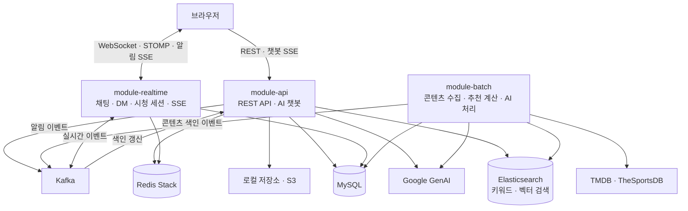

# 모두의 플리 (Modoo Playlist)

---

> **영화·드라마·스포츠 콘텐츠를 발견하고, 취향을 공유하는 AI 큐레이션 커뮤니티 서비스**

무엇을 볼지 고민하는 순간부터, 보고 난 뒤의 감상을 나누는 순간까지 함께합니다.  
사용자는 콘텐츠에 리뷰와 평점을 남기고, 나만의 플레이리스트를 만들어 공유하며, 취향이 비슷한 사용자를 팔로우할 수 있습니다. **AI 큐레이션 챗봇과 개인화 추천**으로 새로운 콘텐츠를 발견하고, **실시간 채팅과 시청 세션**으로 같은 콘텐츠를 보는 사람들과 이야기를 나눕니다.

TMDB·TheSportsDB 기반 콘텐츠 수집부터 취향 분석, 임베딩 생성, 리뷰 요약까지 별도의 **배치 서버**가 처리합니다. API·실시간·배치 서버는 **Gradle 멀티 모듈**로 구성되어 공통 도메인을 공유하면서 각각 실행·배포됩니다.

<br/>

**프로젝트 기간:** `2026.08.24 ~ 2026.10.06`  

<br/>

## 👥 팀 소개 및 주요 기여

| 팀원 | 주요 기여 영역 |
| --- | --- |
| 전태훈 | 사용자 관리, JWT·OAuth2 인증/인가, 임시 비밀번호, 회원 탈퇴 및 물리 삭제 배치, 배포 환경 설정 |
| 배성준 | AI 큐레이션 챗봇, 개인화 추천, 콘텐츠 임베딩, 리뷰 요약, 외부 콘텐츠 수집 배치, ECS 배포 워크플로우 |
| 정우진 | WebSocket 채팅·DM, 실시간 시청 세션, Kafka 기반 실시간 이벤트·SSE, 알림 연동 |
| 윤영주 | 콘텐츠 관리, 콘텐츠 반응, 로컬·S3 이미지 저장, 홈 피드, 배치 모니터링 |
| 이주혜 | 리뷰, 플레이리스트·구독, 팔로우, 알림, 목록 조회 및 쿼리 테스트 |
| 석지예 | Elasticsearch 콘텐츠 검색, 자동완성, 인기 검색어, 전체 재색인·별칭 전환, Kafka 색인 연동 |

<br/>

## 🚩 주요 기능

| 도메인 | 기능 |
| --- | --- |
| 사용자·인증 | 회원가입, 로그인·로그아웃, **Google·Kakao OIDC 로그인**, JWT 재발급, 단일 활성 로그인 세션, 프로필·비밀번호 변경, 이메일 임시 비밀번호 발급 |
| 관리자 | 사용자 조회, 역할 변경, 계정 잠금, 탈퇴 사용자 조기 영구 삭제, 콘텐츠 등록·수정·삭제 |
| 콘텐츠 | 영화·TV 시리즈·스포츠 목록 및 상세 조회, 유형·태그 필터링, 평점·리뷰 수·시청자 수 조회, 썸네일 업로드, 논리 삭제 |
| 검색 | **Nori 한국어 분석 기반 Elasticsearch 검색**, 검색어 자동완성, 최근 7일 인기 검색어, 커서 페이지네이션, 전체 재색인·별칭 전환 |
| 리뷰 | 리뷰 작성·조회·수정·삭제, **사용자당 콘텐츠별 리뷰 1개 제한**, 평점 집계, AI 리뷰 요약 조회 |
| 콘텐츠 반응 | 좋아요·싫어요·관심 없음 설정, 같은 반응 재선택 시 취소, 반응 변경 |
| 플레이리스트 | 플레이리스트 CRUD, 콘텐츠 추가·제거, 구독·구독 취소, 구독 여부·구독자 수 조회, 구독순 정렬 |
| 팔로우 | 팔로우·취소, 팔로워·팔로잉 목록 및 수 조회, 나의 팔로우 상태 조회 |
| 개인화 | 선호 태그, 유사 사용자, 유사 콘텐츠 추천, 유사 사용자 기반 추천, 취향·팔로우·실시간 시청 기반 홈 피드 |
| AI 챗봇 | **SSE 답변 스트리밍**, 의미 검색, 개인화·유사 콘텐츠 추천, 콘텐츠 상세·리뷰 요약 조회, 대화 목록·삭제, 콘텐츠 카드 응답 |
| 실시간 | **WebSocket·STOMP 기반 콘텐츠 채팅 및 DM**, DM 내역·읽음 처리, 시청 세션·참여자 조회, 접속 상태 갱신과 만료 세션 정리 |
| 알림 | 팔로우·플레이리스트·시청 시작·DM·권한 변경 알림, SSE 전달, 개별·전체 읽음 처리, 미확인 알림 수 조회 |
| 배치 | 외부 콘텐츠 동기화, 취향·유사 사용자 재계산, 콘텐츠 임베딩, 리뷰 요약 생성, 탈퇴 사용자 정리 |

<br/>

## 🛠️ 기술 스택

### Language & Framework


### Database & Search


- **MySQL:** 사용자·콘텐츠·리뷰·플레이리스트·대화 등 서비스 데이터 저장
- **Redis Stack:** 로그인 세션, OAuth2 인증 요청 세션, 챗봇 대화 기억, 인기 검색어 등 저장
- **Elasticsearch + Nori:** 한국어 키워드 검색 및 자동완성
- **Elasticsearch 벡터 검색:** 콘텐츠 임베딩 기반 kNN 의미 검색
- **JPA·QueryDSL:** API 도메인 및 조건부 목록 조회 / **MyBatis:** 배치 데이터 조회·일괄 갱신

### AI & External APIs


채팅·리뷰 요약과 텍스트 임베딩에 Google GenAI를 사용합니다. 모델명은 각 서버의 `application.yaml`에 설정되어 있습니다.

### Messaging & Security


### Infrastructure & Observability


Spring Boot Actuator·Micrometer로 배치 실행 횟수, 처리 시간, 읽기·쓰기·건너뛰기 건수를 수집합니다. Compose에는 Logstash·Kibana 구성도 포함되어 있습니다.

### Libraries & Test

Lombok · MapStruct 1.6.3 · Bean Validation · springdoc OpenAPI 3.1.1 · Nimbus JOSE JWT · UUID v7 · JUnit 5 · Mockito · Testcontainers · Playwright · JaCoCo

<br/>

## 📁 프로젝트 구조

> 하나의 저장소에서 공통 라이브러리 2개와 독립 실행 서버 3개를 함께 관리합니다.

```text
modoo_playlist/
├── core/                         # 공통 도메인, 엔티티, DTO, 예외, 점수 계산
│   └── src/main/java/.../core/
│       ├── domain/               # content, user, review, playlist, follow 등
│       └── global/               # 공통 응답, 인증 계약, 실시간 알림 인터페이스
├── infra/                        # 공통 인프라 구현
│   └── src/main/
│       ├── java/.../infra/
│       │   ├── client/           # TMDB, TheSportsDB 클라이언트
│       │   ├── config/           # Redis, S3, 파일 저장, AI, JPA, OpenAPI 설정
│       │   ├── event/            # Kafka 이벤트 및 발행
│       │   ├── security/         # 공통 Access Token 검증
│       │   ├── repository/       # 공통 데이터 접근
│       │   └── store/            # Redis 로그인 세션 및 저장소
│       └── resources/            # DB 스키마·샘플 데이터, AI 프롬프트, 모니터링
├── module-api/                   # REST API 및 AI 챗봇 서버
│   └── src/main/
│       ├── java/.../moduleapi/
│       │   ├── domain/           # 사용자, 콘텐츠, 검색, 리뷰, 추천, 커뮤니티 API
│       │   ├── security/         # JWT 필터, 로그인·로그아웃, OAuth2
│       │   └── event/            # 도메인 이벤트 및 알림 처리
│       └── resources/static/     # 프론트엔드 빌드 결과물
├── module-realtime/              # WebSocket·STOMP 및 SSE 서버
│   └── src/main/java/.../modulerealtime/
│       ├── message/              # 콘텐츠 채팅·DM
│       ├── watchingSession/      # 시청 세션, 연결 상태 및 만료 정리
│       ├── sse/                  # SSE 연결·이벤트 전달
│       ├── security/             # 연결 인증 및 구독 권한 검증
│       └── event/                # Kafka 이벤트 수신
├── module-batch/                 # Spring Batch 서버
│   └── src/main/java/.../modulebatch/
│       ├── tmdb/                 # 영화·TV 콘텐츠 수집
│       ├── sports/               # 스포츠 경기 수집·상태 갱신
│       ├── recommendation/       # 사용자 취향·유사도 계산
│       ├── embedding/            # 임베딩 생성·색인·정리
│       ├── reviewsummary/        # AI 리뷰 요약 생성
│       ├── user/                 # 탈퇴 사용자 정리
│       └── monitoring/           # 배치 메트릭
├── .github/workflows/deploy.yml  # 변경 모듈 감지 및 ECS 배포
├── docker-compose.yml            # 로컬 공통 인프라
├── Dockerfile                    # MODULE 인자로 실행 서버 선택
└── .env.example                  # 환경 변수 예시
```

### 서비스 아키텍처



공통 도메인은 `core`, 외부 시스템 연동은 `infra`가 담당하며 세 실행 서버가 이를 의존합니다. 운영 환경에서는 STOMP·SSE 이벤트를 Kafka로 전달하고, 실시간 서버가 연결된 사용자에게 전송합니다.

<br/>

## 🔐 인증 구조

### JWT + Redis 로그인 세션 + Refresh Rotation

일반 로그인과 Google·Kakao 소셜 로그인은 인증 후 동일한 내부 JWT를 발급합니다. HTTP 보안 컨텍스트는 `STATELESS`로 설정하지만, **로그인 유효성은 Redis 세션과 DB 사용자 상태까지 확인**합니다.

```text
일반 로그인 / Google·Kakao OIDC 로그인
                    ↓
       Access Token + Refresh Token 발급
                    ↓
     Redis에 사용자별 활성 세션·Refresh 해시 저장
                    ↓
API 요청: JWT 검증 → Redis 세션 확인 → DB 사용자 상태 확인
```

| 항목 | 구현 방식 |
| --- | --- |
| Access Token | Bearer 헤더로 전달, 기본 유효기간 30분 |
| Refresh Token | HttpOnly 쿠키에 저장, 기본 유효기간 7일 |
| 갱신 상한 | 최초 로그인 시점부터 최대 30일 범위에서 갱신 |
| Refresh Rotation | Redis Lua 스크립트로 기존 해시 확인과 새 해시·만료 시각 교체를 원자적으로 처리 |
| 중복 로그인 | 사용자별 활성 세션 1개 유지, 새 로그인 시 기존 세션 교체 |
| 로그아웃·사용자 상태 변경 | 세션 무효화 및 사용자 상태 검증으로 접근 통제 |
| CSRF | `XSRF-TOKEN` 쿠키와 `X-XSRF-TOKEN` 헤더 검증 |
| 권한 | `ADMIN > USER` 계층 및 메서드 단위 접근 제어 |
| OAuth2 인증 요청 | Redis 기반 Spring Session으로 인증 진행 상태 공유 |

임시 비밀번호는 기본 3분 동안 유효하며 이메일로 발송됩니다. 임시 비밀번호로 로그인하면 Refresh Token을 발급하지 않고 비밀번호 변경·로그아웃 요청만 허용합니다.

회원 탈퇴는 일반 계정의 비밀번호 확인 또는 소셜 계정의 재인증 후 논리 삭제하며, 배치가 보존 기간을 지난 사용자를 정리합니다. 기본 보존 설정은 `1d`이고, 삭제 기준은 해당 날짜의 자정에서 보존 기간을 뺀 시각입니다.

<br/>

## 🤖 AI 큐레이션 및 추천

### 데이터 조회 도구를 사용하는 챗봇

Spring AI의 Tool Calling으로 서비스 데이터를 조회하고 답변을 생성합니다. 검색·유사 콘텐츠·사용자 취향·개인화 추천·인기 콘텐츠·리뷰 요약·콘텐츠 상세 등 **7종의 도구**를 사용합니다.

- **의미 검색:** 질문을 임베딩하고 Elasticsearch kNN 검색으로 관련 콘텐츠를 찾습니다.
- **대화 기억:** Redis에 최근 10개 메시지를 보관하며 기본 TTL은 24시간입니다.
- **응답 전달:** SSE로 답변을 스트리밍하고, 답변에 언급한 콘텐츠 카드와 대화 ID를 전달합니다.
- **응답 근거:** 콘텐츠 사실은 도구 조회 결과에 근거하도록 프롬프트를 구성하고, 조건에 맞는 검색 결과가 부족하면 한 번 재검색할 수 있습니다.
- **대화 관리:** 본인의 AI 대화 목록을 조회·삭제할 수 있으며, 삭제 커밋 이후 대화 기억도 정리합니다.

### 취향 분석과 개인화 추천

저장된 사용자 상호작용을 점수로 변환하고, 태그별 취향 벡터를 계산합니다.

```text
상호작용 가중치 = 행동별 기본 점수 × min(발생 횟수, 5)
태그 선호 점수 = 누적 가중치 × 0.5^(경과일 / 30) × IDF
IDF = ln(전체 활성 콘텐츠 수 / 해당 태그의 콘텐츠 수)
```

점수 계산기는 좋아요 `+3`, 싫어요 `-3`, 관심 없음 `-2`, 플레이리스트 추가·시청 완료 `+2`를 처리합니다. 리뷰 평점과 시청 시간은 값에 따라 점수를 달리 계산합니다. 실제 계산 대상은 상호작용 테이블에 저장된 기록입니다.

유사 사용자는 태그 선호 벡터의 **코사인 유사도**로 계산하며, 개인화 추천은 유사 사용자 상위 20명을 기준으로 후보를 조회합니다. 유사도와 해당 사용자의 행동 가중치를 곱해 콘텐츠별로 합산하고, 유사 콘텐츠 추천은 콘텐츠 태그의 IDF 벡터를 비교합니다.

홈 피드는 **지금 함께 보는 중 · 취향에 맞는 콘텐츠 · 오늘의 추천 · 팔로우한 사람들이 본 콘텐츠 · 인기 콘텐츠**로 구성하며, 데이터가 없는 항목은 생략합니다.

<br/>

## ⚡ 실시간 통신과 검색 동기화

| 용도 | 경로 |
| --- | --- |
| WebSocket·SockJS 연결 | `/ws` |
| 콘텐츠 채팅 전송 / 구독 | `/pub/contents/{contentId}/chat` / `/sub/contents/{contentId}/chat` |
| DM 전송 / 구독 | `/pub/conversations/{conversationId}/direct-messages` / `/sub/conversations/{conversationId}/direct-messages` |
| 시청 세션 변경 구독 | `/sub/contents/{contentId}/watch` |
| 사용자 알림 SSE | `GET /api/sse` |
| AI 챗봇 SSE | `POST /api/chat/stream` |

WebSocket 연결 시 JWT를 확인하고, DM 구독 시 대화 참여 여부를 추가 검증합니다. 시청 세션은 연결 상태를 주기적으로 갱신하고, 오래된 세션을 만료 처리하며, 종료 처리 실패 건을 재시도합니다.

Kafka는 `stomp-broadcast`, `sse-broadcast`, `content-index` 토픽으로 실시간 전달과 검색 색인 갱신을 연결합니다. 콘텐츠·리뷰·시청자 수 변경을 검색 문서에 반영하며, 전체 재색인은 새 인덱스를 준비한 뒤 별칭을 전환하는 방식으로 처리합니다.

<br/>

## ⚙️ 배치 작업

기본 실행 시각은 **Asia/Seoul** 기준이며 환경 변수로 조정할 수 있습니다.

| 작업 | 기본 실행 주기 | 처리 내용 |
| --- | --- | --- |
| 탈퇴 사용자 정리 | 매일 00:00 | 보존 기간이 지난 탈퇴 사용자 및 연관 데이터 정리 |
| TMDB 콘텐츠 동기화 | 매일 00:00 / 12:00 | 영화·TV 콘텐츠, 출연진·태그 등 수집·갱신 및 검색 색인 이벤트 발행 |
| 취향·유사 사용자 계산 | 매일 00:30 | 상호작용 기반 선호 태그 점수 및 유사 사용자 계산 |
| 콘텐츠 임베딩 | 매일 01:00 | 변경 콘텐츠 임베딩 생성·색인 및 삭제 콘텐츠 벡터 정리 |
| AI 리뷰 요약 | 매일 01:30 | 기본 3개 이상 리뷰가 있는 대상의 최근 리뷰를 최대 30개 사용해 요약 |
| 스포츠 콘텐츠 동기화 | 매일 06:00 / 18:00 | 설정 리그의 경기 일정·팀·경기장 등 수집·갱신 |
| 스포츠 상태 갱신 | 15분 간격 | 경기 시작 시각과 종목별 설정 시간을 기준으로 상태 갱신 |

임베딩 작업은 원본 텍스트·모델·썸네일을 반영한 해시를 비교해 변경이 없는 콘텐츠의 생성을 건너뜁니다. 리뷰 요약은 요청마다 생성하지 않고 배치 결과를 저장해 API와 챗봇에서 조회합니다.

<br/>
